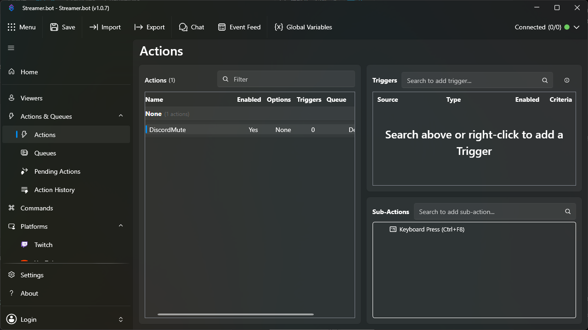
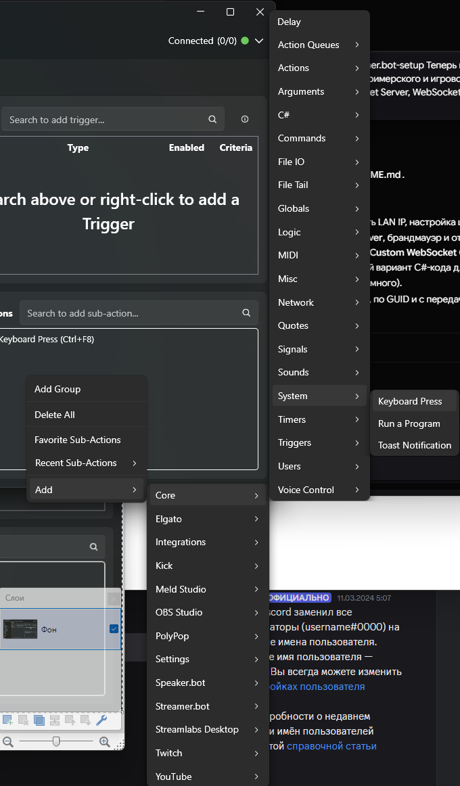
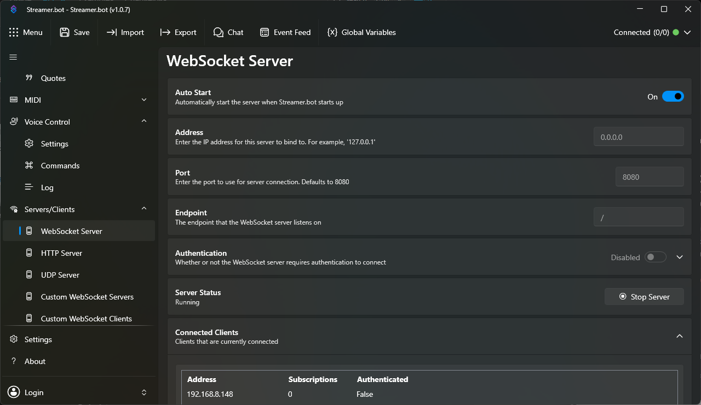
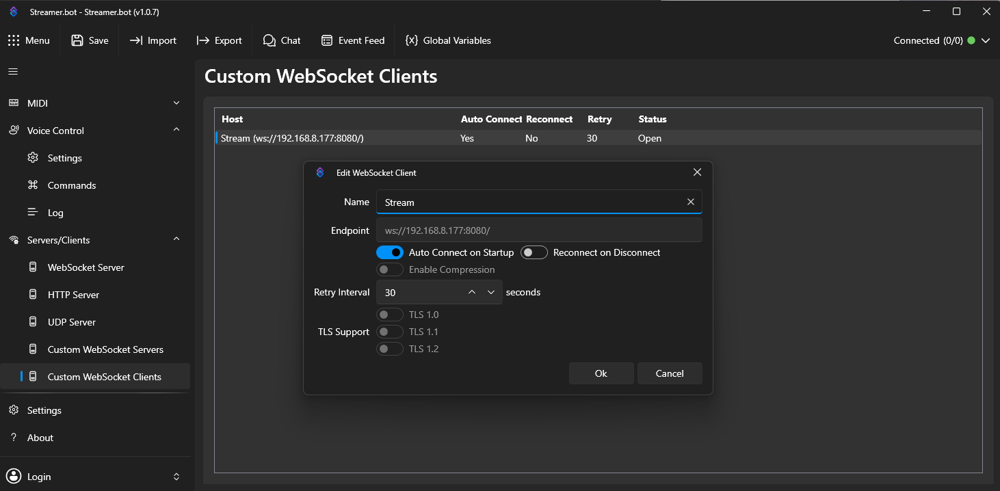
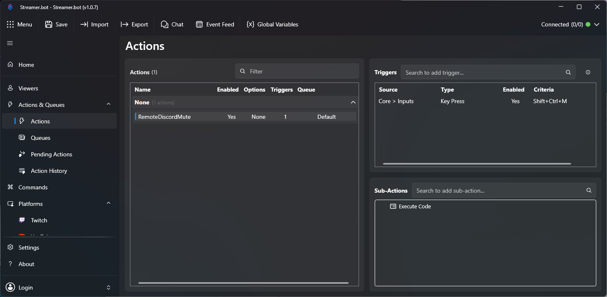
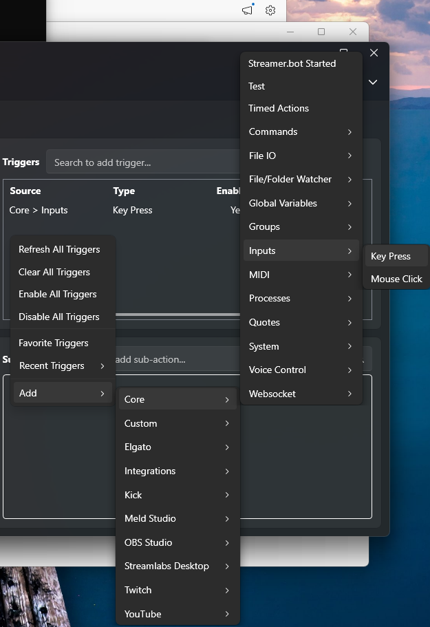
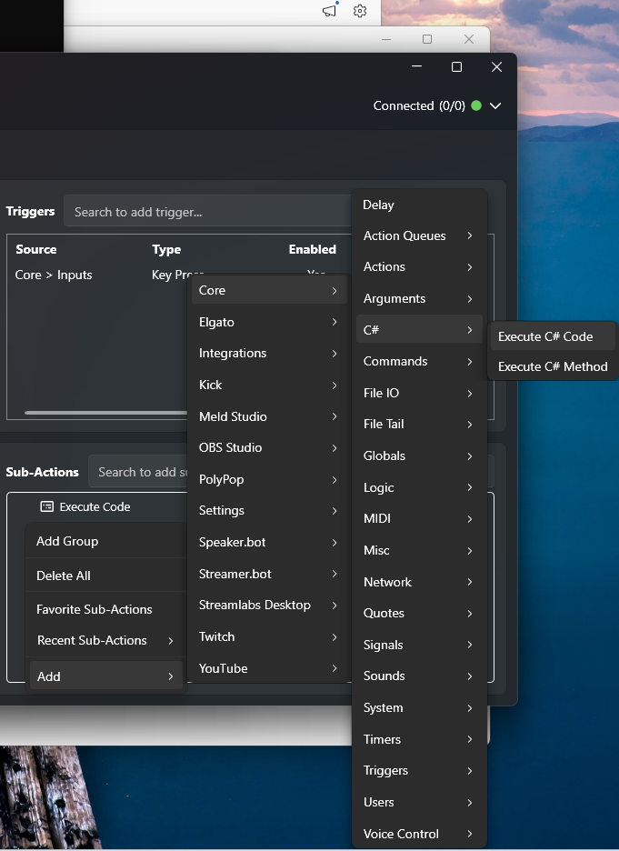
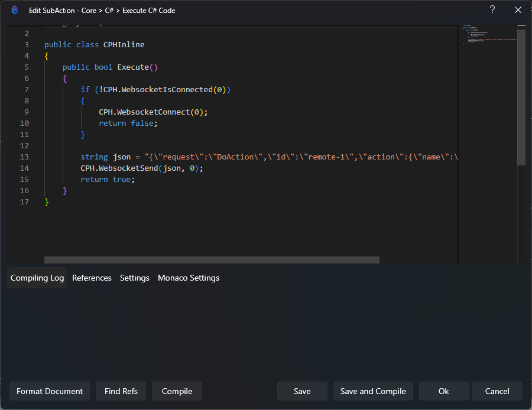

# Связка двух ПК через Streamer.bot 1.0.7 по локальной сети (WebSocket)

Схема управления стрим-ПК с игрового ПК напрямую по LAN **без облачного аккаунта Streamer.bot** и без запуска внешних процессов (PowerShell/curl) на каждое нажатие:

```text
[Игровой ПК]                                     [Стрим-ПК]
Хоткей → Action → CPH.WebsocketSend() ── LAN ──► WebSocket Server (ws://...:8080/)
         (Custom WebSocket Client #0)            → DoAction → Action (например, DiscordMute)
```

* Задержка: ~1–5 мс (постоянное WebSocket-соединение с автопереподключением).
* Облачный аккаунт `Streamer.bot Website` и старые расширения (`.sb`) не требуются.
* Проверено на **Streamer.bot 1.0.7**.

---

## Часть 1. Настройка стрим-ПК (Сервер)

### 1. Узнать локальный IP стрим-ПК
Выполни в PowerShell на стрим-ПК:

```powershell
Get-NetIPAddress -AddressFamily IPv4 |
  Where-Object { $_.IPAddress -notlike '127.*' -and $_.IPAddress -notlike '169.254.*' } |
  Select-Object InterfaceAlias, IPAddress
```

Возьми адрес основного сетевого адаптера (`Ethernet` / `Wi-Fi`), например `192.168.8.177` (виртуальные адаптеры вроде VirtualBox `192.168.56.1` не используем).

> **Совет:** закрепи этот IP за стрим-ПК в настройках DHCP на роутере (резервация по MAC-адресу), чтобы адрес не поменялся после перезагрузки.

### 2. Создать целевой Action (пример: `DiscordMute`)
1. В Discord на стрим-ПК назначь комбинацию клавиш для **Toggle Mute** (например, `Ctrl+F8` или `Ctrl+Shift+F10`).
2. В Streamer.bot открой **Actions** → ПКМ → **Add** → имя `DiscordMute`.
3. В **Sub-Actions** → ПКМ → **Core → System → Keyboard Press** → укажи ту же комбинацию клавиш.
4. Проверь, что Action отрабатывает локально.





### 3. Включить встроенный WebSocket Server
> **Важно:** используй именно основной **WebSocket Server**, а **не** `Custom WebSocket Servers` — только основной сервер из коробки понимает JSON-команду `DoAction`.

Открой **Servers/Clients → WebSocket Server** и задай:

| Параметр | Значение |
|---|---|
| **Auto Start** | `On` |
| **Address** | `0.0.0.0` *(или конкретный LAN IP стрим-ПК, например `192.168.8.177`)* |
| **Port** | `8080` |
| **Endpoint** | `/` |
| **Authentication** | `Disabled` *(клиентский `CPH.WebsocketSend` не проходит SHA-256 handshake)* |

Нажми **Start Server** — статус должен стать `Running`.



### 4. Брандмауэр Windows и безопасность
* Убедись, что сеть на стрим-ПК имеет профиль **Private** (Частная).
* При первом запуске разреши `Streamer.bot.exe` доступ в частных сетях. В идеале ограничь входящее правило на порт `8080/TCP` только IP-адресом игрового ПК.
* Если **Servers/Clients → HTTP Server** (порт `7474`, без авторизации) не используется — останови его и выключи **Auto Start**.

---

## Часть 2. Настройка игрового ПК (Клиент)

Входить в аккаунт сайта Streamer.bot не нужно.

### 1. Подключить Custom WebSocket Client
Открой **Servers/Clients → Custom WebSocket Clients** → ПКМ по пустому полю → **Add**.

> **Важно про поле `Endpoint`:** отдельного поля `Host/Port` в окне нет, а в `Endpoint` по умолчанию стоит `/`. Его нужно **стереть** и вписать полный `ws://` URI.

| Параметр | Значение |
|---|---|
| **Name** | `StreamPC` |
| **Endpoint** | `ws://192.168.8.177:8080/` *(подставь IP своего стрим-ПК)* |
| **Auto Connect on Startup** | `On` |
| **Reconnect on Disconnect** | `On` |
| **Enable Compression** | `Off` |
| **Retry Interval** | `5` seconds |
| **TLS Support** | оставить как есть (для `ws://` не используется) |

Нажми **Ok**, затем ПКМ по созданной строке → **Connect**.



**Проверка подключения:** на стрим-ПК в **Servers/Clients → WebSocket Server → Connected Clients** должен сразу появиться IP игрового ПК.

> Первый клиент в списке **Custom WebSocket Clients** имеет индекс **`0`** (второй — `1` и т. д.).

---

### 2. Создать Action с хоткеем (пример: `RemoteDiscordMute`)

1. Открой **Actions** → ПКМ → **Add** → имя `RemoteDiscordMute`.

   

2. В **Triggers** → ПКМ → **Core → Inputs → Key Press** (или **Global Hotkey**) → назначь клавишу.

   

3. В **Sub-Actions** → ПКМ → **Core → C# → Execute C# Code**.

   

4. Вставь код:

```csharp
using System;

public class CPHInline
{
    public bool Execute()
    {
        if (!CPH.WebsocketIsConnected(0))
        {
            CPH.WebsocketConnect(0);
            return false;
        }

        string json = "{\"request\":\"DoAction\",\"id\":\"remote-1\",\"action\":{\"name\":\"DiscordMute\"}}";
        CPH.WebsocketSend(json, 0);
        return true;
    }
}
```

   

5. Нажми **Compile** (проверь, что без ошибок) → **Save and Compile**.

### 3. Как добавить ещё команды
Нажми **ПКМ по готовому Action → Duplicate**, поменяй горячую клавишу в **Triggers** и в C#-коде замени `"DiscordMute"` на точное имя нужного Action на стрим-ПК.

---

## Справочник формата команд `DoAction`

### Вызов по имени Action
```json
{
  "request": "DoAction",
  "id": "remote-1",
  "action": {
    "name": "DiscordMute"
  }
}
```

### Вызов по GUID (если Action может переименовываться)
```json
{
  "request": "DoAction",
  "id": "remote-1",
  "action": {
    "id": "9bd60a38-ee1c-43e2-aead-fc015a6bbec2"
  }
}
```

### Вызов с передачей аргументов на стрим-ПК
```json
{
  "request": "DoAction",
  "id": "remote-1",
  "action": {
    "name": "SwitchScene"
  },
  "args": {
    "sceneName": "Gaming",
    "delayMs": 200
  }
}
```
На стрим-ПК эти значения сразу доступны как `%sceneName%` и `%delayMs%` (или через `CPH.TryGetArg(...)`).

---

## Быстрая диагностика, если не работает

1. **Проверка доступности порта с игрового ПК (PowerShell):**
   ```powershell
   Test-NetConnection 192.168.8.177 -Port 8080
   ```
   * `TcpTestSucceeded : False` → порт `8080` блокирует брандмауэр/антивирус или на стрим-ПК сеть в профиле `Public`.
   * `TcpTestSucceeded : True` → сеть открыта, проверяй настройки клиента.

2. **Типичные ошибки:**
   * В `Custom WebSocket Clients → Endpoint` указан просто IP вместо `ws://192.168.8.177:8080/`.
   * На стрим-ПК запущен `Custom WebSocket Servers` вместо основного `WebSocket Server`.
   * На стрим-ПК включена `Authentication` на WebSocket Server.
   * Не совпадает имя Action в JSON (`"name":"..."`) с точным именем Action на стрим-ПК (регистр букв имеет значение).
   * В `CPH.WebsocketSend(json, 0)` указан неверный индекс клиента (если в списке `Custom WebSocket Clients` несколько записей, индекс идёт с `0` сверху вниз).
